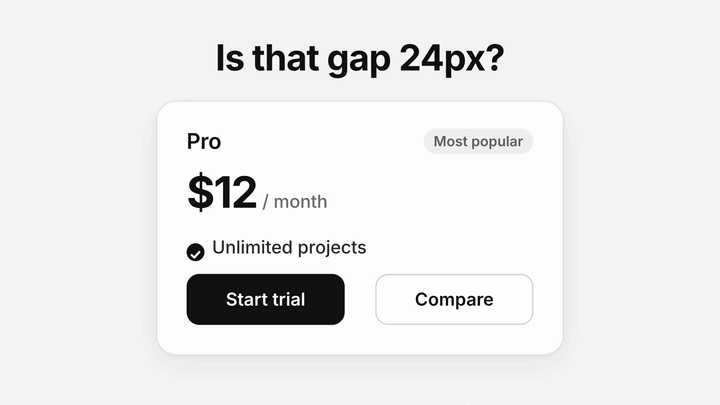

# Guides

A small macOS menu bar app for measuring and marking what you see on screen.

Place guides, measure an area, copy a value, then **Pin & work** to keep the overlay visible while using the app underneath. Useful when checking a browser, a design, an image or a desktop interface.


*Native app views on a sample background. Selected guides and their measurement are cyan.*

[](docs/video/guides-promo.mp4)

*Preview of the [45-second overview video](docs/video/guides-promo.mp4), which has sound. It is a motion-graphics recreation of the interface, not a screen recording; see the [video notes](docs/video/README.md).*

## What it does

- **Measure spacing:** place horizontal or vertical guides and read the gaps between them.
- **Measure an area:** read width, height and a manually fitted corner radius.
- **Move measurement labels:** drag a width label up/down or a height label left/right without moving its guides.
- **Copy for development:** plain values, CSS declarations, Tailwind classes and matching spacing-token variables.
- **Mark a detail:** draw arrows, lines or rectangles; use a rectangle as a spotlight.
- **Compare and reuse:** a spacing grid, local reference images, saved layouts, project profiles and breakpoint markers.
- **Use local tools:** inspect an image's dimensions or resize a chosen app window.

Guides measures visible distances manually. It does not read CSS, Figma layers or the source properties of another app.

## Download and open

Download [Guides 0.2.1 preview](https://github.com/parveshh/guides/releases/tag/v0.2.1). Choose **Guides-0.2.1-macOS-universal.zip**. It includes **Guides.app**, the **guides** CLI launcher, the agent skill and **INSTALL.txt**; the source-code archives contain source only.

The build includes **Apple Silicon and Intel** code and requires **macOS 14 or later**. Runtime checks were performed on Apple Silicon; Intel and older supported macOS versions still need testing. Xcode is not needed to run the download.

1. Unzip the download and drag **Guides.app** to **Applications**.
2. Quit any older copy of Guides, then open the installed app.
3. Look for the ruler icon in the menu bar. Guides has no Dock icon.

This preview is **ad hoc signed, not Developer ID signed or notarized**. macOS may block its first launch. If you trust this download, try opening it once, then use **System Settings → Privacy & Security → Open Anyway** and confirm **Open**. See [Apple's instructions](https://support.apple.com/en-us/102445). No security settings are changed by the app or build script.

The release includes a SHA-256 checksum and [release notes](docs/releases/0.2.1.md). To update, quit old copies and replace the app in Applications with the new copy.

## Build from source

You need **Xcode 26 or later with Swift 6.2 or later**. Select the full Xcode installation as your active developer directory. The development build script targets Apple Silicon; the release script builds both architectures.

```sh
git clone https://github.com/parveshh/guides.git
cd guides
./scripts/test.sh
./scripts/build.sh
```

Open `build/DerivedData/Build/Products/Debug/Guides.app` in Finder. A ruler icon appears in the menu bar; there is no Dock icon. You can also open `Guides.xcodeproj`, select **Guides → My Mac**, and run it in Xcode.

Initial dependency downloads need an internet connection. Guides itself has no network features.

To package the same universal preview locally, run `./scripts/release.sh`. It creates the app ZIP and checksum in `build/releases/` and does not publish them. See the [release build notes](docs/RELEASING.md).

## Your first measurement

1. Press **Control–Option–G**, or choose **Edit Guides** from the menu bar icon.
2. Pull guides from the top or left ruler onto the edges you want to compare.
3. Click a distance. Its two guides turn cyan; choose **Copy** in the nearby panel.
4. Choose **Pin & work** to click and type in the app underneath. Use the shortcut again to resume editing.
5. Choose **Hide** to put the overlay away.

For CSS pixels or rem, use **Set scale** first. The default **Screen pt** unit means macOS logical points, not CSS pixels.

Read the [usage guide](docs/USAGE.md) for controls, calibration, all tools and keyboard shortcuts.

## CLI and agent skill

The **0.2.1 download** includes direct app commands and a `$guides` skill for CLI or computer use. Open its app, then run `./guides --help` from the unzipped folder. **INSTALL.txt** explains adding the launcher to PATH and installing the skill. Quit old copies once when updating, after saving layouts you want to keep. The original 0.1.0 app does not support CLI commands.

Guides keeps one GUI instance per user. Repeated `guides launch` calls reuse its PID/path and preserve the current session; patched app copies also guard direct and simultaneous launches. The skill attaches to that running path. CLI commands use short-lived client processes without creating another menu or overlay.

From this checkout:

```sh
./skills/guides/scripts/guides launch
./skills/guides/scripts/guides displays
./skills/guides/scripts/guides show guides
./skills/guides/scripts/guides gap vertical 300 364
./skills/guides/scripts/guides read
./skills/guides/scripts/guides pin
```

This places a **64-screen-point width** at supplied coordinates; it does not detect a visible element. Commands return JSON. For design pixels or code output, explicitly confirm the view scale with `calibrate PERCENT`, then choose `unit design-px` or `unit rem`. Use `--help` for all commands. See the [CLI reference](skills/guides/references/cli.md) for display selection, units, undo and error handling.

After launch, retry read-only `status` briefly if the app is still starting. An agent's execution sandbox may block local Mach messaging; use its normal command-approval path when needed. No Guides privacy grant is required for the CLI.

To add `guides` to your PATH and install the skill locally, run from the repository root (these links fail safely if a destination already exists):

```sh
mkdir -p "$HOME/.local/bin" "$HOME/.codex/skills"
ln -s "$PWD/skills/guides/scripts/guides" "$HOME/.local/bin/guides"
ln -s "$PWD/skills/guides" "$HOME/.codex/skills/guides"
```

Ensure `~/.local/bin` is on PATH. Keep this checkout in place while using these links. To use another build, set `GUIDES_APP` to its full `.app` path. The [skill](skills/guides/SKILL.md) includes a computer-use route for visible alignment, annotations and the other local tools; desktop-control tools must be available in that agent session. In Codex, invoke it as `$guides`; from a terminal:

```sh
codex '$guides Use the CLI to place a 64-screen-point vertical guide gap and pin it.'
```

Single quotes preserve the literal `$guides`. Local skill discovery and invocation follow [OpenAI's skill documentation](https://learn.chatgpt.com/docs/build-skills). Restart Codex if the newly installed skill is not listed. The CLI uses local Mach messages accessible to processes in your login session. It has no network listener or permission-request commands; optional Accessibility and Screen Recording tools remain in the UI.

## Things to try

| Use case | Workflow |
| --- | --- |
| Check spacing between two buttons | Place guides at the facing edges, select the gap and copy it. |
| Measure a card or dialog | Draw an Area; choose Width, Height or Both. |
| Check a rounded corner | Fit an Area to the bounds, then adjust Radius by eye. |
| Point something out during a review | Draw an arrow or spotlight rectangle, then Pin & work. |
| Check an image asset | Open Inspect Image to read and copy its original pixel dimensions. |
| Try a different window size | Choose a target in Resize Window, apply a preset and check the reported size. |

See [step-by-step examples](docs/USAGE.md#examples).

## Local data and optional access

Normal measurements, annotations, grids and supplied-image tools work without privacy grants.

- **Resize Window** optionally uses Accessibility access for the window you choose.
- **Corner Magnifier** optionally uses Screen Recording while you explicitly run the preview. Its images stay in memory and are never saved, copied or sent.
- Permissions are requested only from their tool's dedicated button.

Settings, spacing scales, breakpoints, profiles and saved layouts stay on your Mac. Measurements, calibration, label positions and reference images start fresh after quitting. Saved layouts load only when you choose them.

## Development status

Guides is an early preview. The core has **148 passing tests**, with native view and event-handler checks. Physical input, VoiceOver and some display/OS scenarios still need manual verification; see [TESTING.md](TESTING.md).

- [Usage guide and examples](docs/USAGE.md)
- [Validation and remaining checks](TESTING.md)
- [Product plan and roadmap](PLAN.md)
- [Implementation and review instructions](AGENTS.md)
- [Screenshot source notes](docs/screenshots/README.md)
- [Overview video notes](docs/video/README.md)

The app uses Swift, AppKit and SwiftUI. Its geometry and editing core is a local Swift package; [KeyboardShortcuts](https://github.com/sindresorhus/KeyboardShortcuts) is pinned to 3.0.1. Build output is kept in the ignored `build/` folder.
