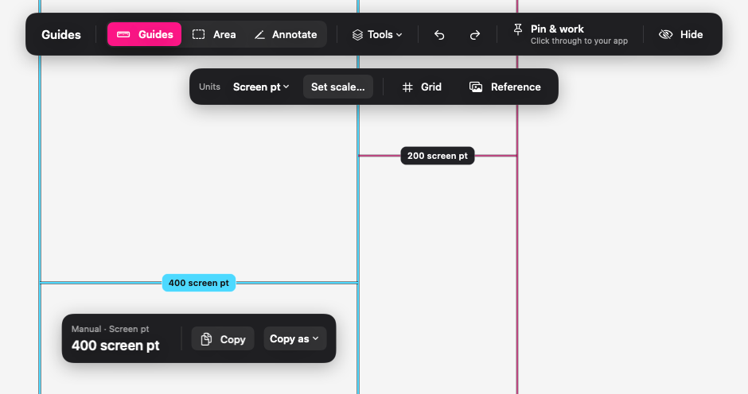

# Guides

A small macOS menu bar app for measuring and marking what you see on screen.

Place guides, measure an area, copy a value, then **Pin & work** to keep the overlay visible while using the app underneath. Useful when checking a browser, a design, an image or a desktop interface.



*Native app views on a sample background. Selected guides and their measurement are cyan.*

## What it does

- **Measure spacing:** place horizontal or vertical guides and read the gaps between them.
- **Measure an area:** read width, height and a manually fitted corner radius.
- **Move measurement labels:** drag a width label up/down or a height label left/right without moving its guides.
- **Copy for development:** plain values, CSS declarations, Tailwind classes and matching spacing-token variables.
- **Mark a detail:** draw arrows, lines or rectangles; use a rectangle as a spotlight.
- **Compare and reuse:** a spacing grid, local reference images, saved layouts, project profiles and breakpoint markers.
- **Use local tools:** inspect an image's dimensions or resize a chosen app window.

Guides measures visible distances manually. It does not read CSS, Figma layers or the source properties of another app.

## Build and open

This repository contains source code. A signed installer is not provided.

You need an **Apple Silicon Mac** and **Xcode 26 or later with Swift 6.2 or later**. Select the full Xcode installation as your active developer directory. The app targets macOS 14 and later; older supported macOS versions and Intel Macs have not been validated.

```sh
git clone https://github.com/parveshh/guides.git
cd guides
./scripts/test.sh
./scripts/build.sh
```

Open `build/DerivedData/Build/Products/Debug/Guides.app` in Finder. A ruler icon appears in the menu bar; there is no Dock icon. You can also open `Guides.xcodeproj`, select **Guides → My Mac**, and run it in Xcode.

Initial dependency downloads need an internet connection. Guides itself has no network features.

## Your first measurement

1. Press **Control–Option–G**, or choose **Edit Guides** from the menu bar icon.
2. Pull guides from the top or left ruler onto the edges you want to compare.
3. Click a distance. Its two guides turn cyan; choose **Copy** in the nearby panel.
4. Choose **Pin & work** to click and type in the app underneath. Use the shortcut again to resume editing.
5. Choose **Hide** to put the overlay away.

For CSS pixels or rem, use **Set scale** first. The default **Screen pt** unit means macOS logical points, not CSS pixels.

Read the [usage guide](docs/USAGE.md) for controls, calibration, all tools and keyboard shortcuts.

## Things to try

| Use case | Workflow |
| --- | --- |
| Check spacing between two buttons | Place guides at the facing edges, select the gap and copy it. |
| Measure a card or dialog | Draw an Area; choose Width, Height or Both. |
| Check a rounded corner | Fit an Area to the bounds, then adjust Radius by eye. |
| Point something out during a review | Draw an arrow or spotlight rectangle, then Pin & work. |
| Check an image asset | Open Inspect Image to read and copy its original pixel dimensions. |
| Try a different window size | Choose a target in Resize Window, apply a preset and check the reported size. |

See [step-by-step examples](docs/USAGE.md#examples).

## Local data and optional access

Normal measurements, annotations, grids and supplied-image tools work without privacy grants.

- **Resize Window** optionally uses Accessibility access for the window you choose.
- **Corner Magnifier** optionally uses Screen Recording while you explicitly run the preview. Its images stay in memory and are never saved, copied or sent.
- Permissions are requested only from their tool's dedicated button.

Settings, spacing scales, breakpoints, profiles and saved layouts stay on your Mac. Measurements, calibration, label positions and reference images start fresh after quitting. Saved layouts load only when you choose them.

## Development status

Guides is a personal development build. The core has **139 passing tests**, with native view and event-handler checks. Physical input, VoiceOver and some display/OS scenarios still need manual verification; see [TESTING.md](TESTING.md).

- [Usage guide and examples](docs/USAGE.md)
- [Validation and remaining checks](TESTING.md)
- [Product plan and roadmap](PLAN.md)
- [Implementation and review instructions](AGENTS.md)
- [Screenshot source notes](docs/screenshots/README.md)

The app uses Swift, AppKit and SwiftUI. Its geometry and editing core is a local Swift package; [KeyboardShortcuts](https://github.com/sindresorhus/KeyboardShortcuts) is pinned to 3.0.1. Build output is kept in the ignored `build/` folder.
