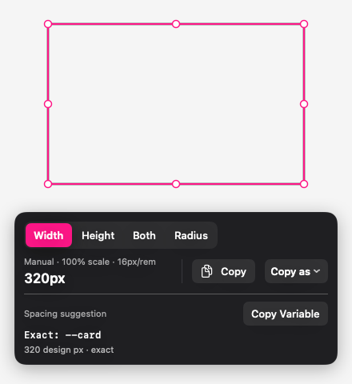
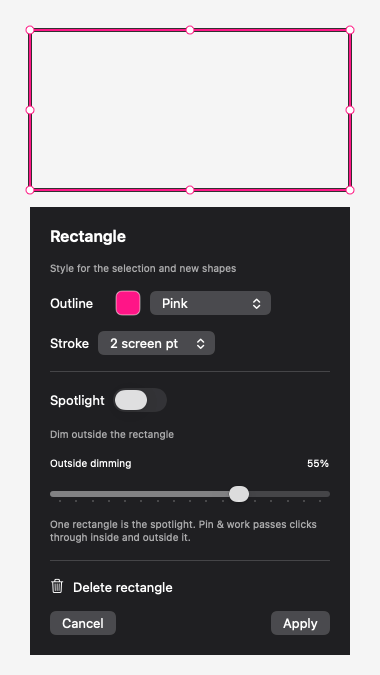

# Using Guides

[Back to README](../README.md)

Guides floats over the app you are checking. You place the boundaries yourself, read a distance and copy it. Nothing is inspected inside the other app.

- [Measure spacing](#measure-spacing)
- [Measure an area and corners](#measure-an-area-and-corners)
- [Units and scale](#units-and-scale)
- [Copy values for code](#copy-values-for-code)
- [Annotate and spotlight](#annotate-and-spotlight)
- [Grid and reference images](#grid-and-reference-images)
- [Project tools](#project-tools)
- [Images and window sizes](#images-and-window-sizes)
- [Keyboard shortcuts](#keyboard-shortcuts)
- [Examples](#examples)
- [Troubleshooting](#troubleshooting)

## Start and return to your work

Open Guides and look for the ruler icon in the menu bar. Press **Control–Option–G** to start editing on the display under your pointer. Change this shortcut in **Settings**.

| State | What happens |
| --- | --- |
| Editing | The overlay receives clicks so you can place and edit measurements. |
| Pin & work | Marks stay visible. Clicks and typing go to the app underneath. The activation shortcut resumes editing. |
| Hide | The overlay disappears. Activate on the same display to return to that session. |

On the canvas, **Escape** cancels an unfinished drag; otherwise it hides the overlay. In reference alignment, Escape finishes alignment first. Closing a draft editor discards its unsaved changes.

## Measure spacing

1. Choose **Guides**.
2. Drag down from the top ruler to add a horizontal guide, or right from the left ruler to add a vertical guide.
3. Align two parallel guides with the boundaries you want to compare. Adjacent gaps appear automatically.
4. Click a measurement to select its two guides. The pair, connector and label turn **cyan**; other guides stay pink.
5. Choose **Copy**, or press **Command-C** while the canvas has focus.

Shift-click two parallel guides to measure a nonadjacent pair. Drag a guide to move it, use arrow keys for small adjustments, or press Delete to remove it.

A guide's position is the centre of its line. The drawn line thickness does not change the distance. Pointer placement snaps to backing-pixel boundaries; hold **Control** during a drag to place freely. This does not detect edges in the app underneath.

### Move a measurement out of the way

Drag the small measurement label:

| Measurement | Label movement |
| --- | --- |
| Width between vertical guides | Up or down |
| Height between horizontal guides | Left or right |

The guides and value stay fixed. The Copy panel follows; labels avoid the toolbar where space allows. Escape cancels a drag, and Command-Z/Shift-Command-Z undo/redo completed moves. VoiceOver has directional **Move label** actions with normal 10-point steps, skipping the toolbar when needed.

Label positions stay with each guide pair for this run, including hide/pin and display switching. Deleting a boundary removes its label position. New launches and saved-layout loads use default positions.

## Measure an area and corners

Choose **Area**, then drag a rectangle around an element. Drag its body to move it, or its handles to resize it. Drawing elsewhere replaces the current Area; undo restores the previous one.

Select **Width**, **Height** or **Both** in the readout before copying.



*An Area showing a calibrated 320px width and a matching local spacing token.*

For a corner radius:

1. Fit the Area bounds to the visible edges, leaving out any shadow.
2. Choose **Radius** in the readout, or **Measure Corner Radius** from the menu bar.
3. Enter a radius in screen points and choose **Apply**, or adjust with **− / +**.
4. Compare the outline with the visible corner, then copy the estimate.

The fit uses equal circular corners. It is a manual estimate for continuous curves or unequal corners. **Border** changes outline opacity; 0% hides the border while keeping editing controls visible.

### Optional corner magnifier

Choose **Magnifier…**, select a corner and zoom level, then **Start Magnifier**. Use its dedicated **Request Screen Recording…** button if access is needed, then **Check Access**. You can make quarter-point radius adjustments in the preview.

Capture stops when you Stop or close the preview, pin/hide, change tools or selection, or the display changes or sleeps. Reopening does not restart it. Images stay in memory; nothing is saved or sent. Normal radius fitting needs no capture access.

## Units and scale

| Unit | Meaning |
| --- | --- |
| Screen pt | macOS logical points. `32 screen pt` is not CSS `32pt`. |
| Backing px | Pixels in the overlay's backing coordinates; not a claim about physical display pixels. |
| Design px | Screen distance converted using the scale you supply. |
| rem | Calibrated design pixels divided by your root font size, normally 16px. |

Use **Set scale** before Design px, rem or code-format copying. Choose either:

- **View scale:** enter the zoom percentage you are measuring. Confirming 100% means one screen point per design pixel.
- **Known size:** select a guide gap or Area dimension and enter its known size in pixels.

Update the scale when the app or zoom changes. A 64-screen-point distance at 200% becomes **32px**, or **2rem** with a 16px root.

Calibration converts a visual measurement. It does not reveal the CSS or Figma property that produced it.

## Copy values for code

**Copy** and **Command-C** copy the displayed value. **Copy as** offers CSS and Tailwind output after you confirm the scale.

| Selection | Example CSS | Example Tailwind |
| --- | --- | --- |
| Guide gap | `gap: 24px;` | `gap-[24px]` |
| Area Width | `width: 320px;` | `w-[320px]` |
| Area Height | `height: 48px;` | `h-[48px]` |
| Area Both | Width and height on separate lines | `w-[320px] h-[48px]` |
| Area Radius | `border-radius: 8px;` | `rounded-[8px]` |

Code formats use Design px, or rem when rem is selected. Even with Screen pt or Backing px displayed, code formats require confirmed calibration. Menu items show exactly what they copy.

A guide gap might represent padding, margin or spacing. The suggested `gap` declaration is a starting point. Tailwind uses arbitrary values because Guides does not know your theme.

## Annotate and spotlight

1. Choose **Annotate**, then **Arrow**, **Line** or **Rectangle**.
2. Drag to draw. The app switches to **Select** when you finish.
3. Move the shape by its body; use endpoints or handles to adjust it.
4. Use the colour well to recolour the selection and set the next drawing colour.
5. Open **Style** for stroke width, spotlight and outside dimming. **Apply** saves the draft; **Cancel** discards it.



New rectangles are spotlights by default. Their interior remains live and undimmed while the rest of the display darkens. Only one rectangle is the active spotlight; turn it off in Style for an ordinary outline.

**Transparent** hides a shape's stroke while keeping it editable and preserving a rectangle's spotlight. Editing handles remain visible until you pin. Use bracket keys to select an invisible shape and choose a visible colour again.

Delete a selection from Style or with Delete. **Tools → Clear Annotations** removes only annotations and spotlight. Annotation undo is separate from measurement undo. **Pin & work** passes input through the whole overlay, including the clear spotlight area.

## Grid and reference images

With Guides or Area active, use the smaller strip below the main bar:

| Tool | How to use it |
| --- | --- |
| Square grid | Open **Grid**, enable it, set spacing/unit/origin/opacity, then Apply. Design px/rem cells need calibration. |
| Reference | Open **Reference → Open Image…** and choose a local raster image. Set position, width and opacity; its aspect ratio stays fixed. |

Grid units are separate from the measurement readout's unit.

For a reference, **Apply & align on canvas** enables dragging and arrow-key adjustment. Escape finishes alignment. Choose Guides or Area to return to measuring. A reference is manually aligned; it does not track windows or compare pixels automatically.

Grid and reference images remain visible when pinned. Clear Measurements leaves them alone. Quitting clears both; reference images and paths are not saved in layouts.

Choose Solid or Transparent ruler backgrounds in **Tools** or **Settings → Rulers**.

## Project tools

These are available from **Tools** and the menu bar icon.

### Spacing Tokens

Enter one declaration per line, then **Save Scale**:

```css
--space-1: 4px;
--space-2: 8px;
--space-4: 16px;
--space-6: 24px;
```

Use a plain declaration list, without selectors, braces or expressions. Up to 64 tokens are supported. **Use Example** fills a sample scale; nothing is read from your project files.

Select a calibrated gap or Area Width/Height to compare it with the scale. **Copy Variable** works only for a unique match within tolerance. Ties and aliases are not picked automatically. The default tolerance is 1 design pixel. With the sample scale above, a calibrated 24px gap copies `var(--space-6)`.

### Breakpoints

Enter named widths in pixels, then **Save Breakpoints**:

```text
sm: 640px
md: 768px
lg: 1024px
```

After Set scale, blue markers appear on the top ruler. Positions are measured from the **display's left edge**, not a detected browser viewport. Markers are references, not draggable guides. They disappear with the rulers when pinned or annotating.

### Project Profiles and Saved Layouts

| Tool | Saves | Applying or loading |
| --- | --- | --- |
| Project Profiles | Rem base, spacing tokens/tolerance and breakpoints | Replaces those settings explicitly. Does not move geometry or change the view scale. Undo Apply restores the previous settings. |
| Saved Layouts | Guides, Area/radius, grid and annotations/spotlight | Requires the same screen-point dimensions and backing factor. Replaces geometry and resets calibration and tool histories. |

Use **Save Current**, give the entry a name, then select it to Apply/Load, Rename or Delete. Saving is a snapshot; later edits do not update it. Nothing loads automatically on launch. Opening Project Profiles closes an unsaved token or breakpoint draft, and the reverse.

After a layout load, **Undo Layout Load** restores the previous setup and histories for that display. It is separate from ordinary Command-Z. Reference images, calibration and label positions are not stored in the layout file.

## Images and window sizes

### Inspect Image

Choose **Inspect Image…**, then open a file, drop one image, or choose **Paste Image**. Read and copy original pixel dimensions, aspect ratio, format, file size and alpha-channel presence. The preview is scaled; calibration does not change source pixel counts.

PNG, JPEG, TIFF, GIF and HEIC are supported through macOS Image I/O, up to 100 MiB per input. Multi-image files show their primary image and count without animation. SVG/PDF, remote URLs and batches are not supported. Clipboard images can differ from the original file. Clear or close to discard the image; it is not saved.

### Resize Window

1. Choose **Resize Window…** and use its dedicated Accessibility request button if needed.
2. Choose **Use App's Front Window** and check the displayed app/title. Switching apps does not silently change this target.
3. Enter a width/height or select a preset, then choose **Resize Window**.
4. Read the actual accepted size. Use **Restore Previous Frame** to return to the frame saved before the latest attempt.

Sizes are whole-window **screen points**, including browser chrome. They are not exact CSS viewport sizes. Apps can enforce minimum sizes or clamp large requests. Breakpoint presets set width only and keep the height.

## Keyboard shortcuts

Click the canvas to focus editing keys. Toolbar controls and text fields keep their usual keyboard behaviour.

| Shortcut | Action |
| --- | --- |
| Control–Option–G | Activate; toggle between editing and pinned |
| H / V | Add a horizontal / vertical guide at the pointer |
| [ / ] | Select previous / next measurement or annotation |
| Shift + [ / ] | Extend selection to a parallel guide |
| Arrow keys | Move selection by 1 screen point |
| Shift + Arrow | Move by 10 screen points |
| Option + Arrow | Move by 1 backing pixel |
| Control + drag | Place a guide or Area edge freely |
| Delete | Delete selection |
| Command-C | Copy the selected measurement |
| Command-Z / Shift-Command-Z | Undo / redo in the active tool |
| Escape | Cancel a gesture, finish alignment, or hide |

Arrow keys move guides or shapes; dragging a gap label moves only the label. The activation shortcut can be changed in Settings.

## Examples

### Check spacing between two buttons

Place vertical guides at the facing edges of the buttons. Click the gap and move its label above or below the buttons if it blocks your view. Confirm the scale, then use Copy as. A calibrated 24px gap can copy as `gap: 24px;`, `gap-[24px]` or `1.5rem` at a 16px root. Decide which CSS property fits your layout.

### Measure a card

Draw an Area around the card's visible bounds. Choose **Both** to copy width and height together. At a confirmed 100% scale, a 320×200-screen-point Area produces `width: 320px;` and `height: 200px;`. Use Width or Height for a single value.

### Fit a rounded corner

Fit the Area to the panel, select Radius and adjust the curve by eye. A 32-screen-point radius at 200% calibration is 16px, or 1rem at a 16px root. Use the optional magnifier when you need a closer look.

### Highlight a detail during a review

Draw an arrow or rectangle around the detail. Adjust Style, then **Pin & work** so you can keep using the underlying app while the marks remain visible. This displays an overlay; Guides does not export an annotated screenshot.

### Check an image asset

Open the original image in Inspect Image. A 1024×768 image reports a 4:3 aspect ratio; copy its source dimensions without guessing from the scaled preview.

### Try a smaller browser window

Choose the browser's window in Resize Window. Select a preset such as 1280×720, apply it and read the accepted size. Restore when finished. Use the browser's own responsive tools if you need an exact CSS viewport.

## What is kept

Settings, spacing tokens, breakpoints, project profiles and saved layouts stay on this Mac. Layouts and profiles are stored in `~/Library/Application Support/Guides/`.

Measurements, calibration, label positions, reference images and grid viewing state are kept only for the current run. Hide and Pin retain them; quitting starts fresh. Only one display is active at a time. A display disconnect or size/backing change clears that display's session.

There is no account, sync or app network activity. The app runs outside App Sandbox to support optional window resizing. Measurements and supplied-image tools need no privacy grant. Accessibility is optional for resizing a chosen window; Screen Recording is optional for the active corner magnifier. Permissions are requested only from explicit buttons.

## Troubleshooting

| Problem | What to do |
| --- | --- |
| I cannot click the app underneath | Choose Pin & work or Hide. Editing deliberately receives clicks. |
| Design px/rem or code copying is unavailable | Select a measurement and confirm Set scale. |
| The value looks wrong after zooming | Update calibration for the new view or zoom. |
| Grid says paused | Check calibration and cell spacing; cells must be at least 4 screen points apart. |
| A saved layout will not load | Match its screen-point dimensions and backing factor. Geometry is never silently scaled. |
| Accessibility is enabled but resizing is denied | A rebuild can change the local app's identity. Re-add the current build in macOS privacy settings, then Check Access. |
| The magnifier has no preview | Check Screen Recording access, then explicitly Start Magnifier. |
| Guides disappeared | Check the menu bar. Escape hides the overlay; the activation shortcut returns to editing. |

For build instructions, return to the [README](../README.md). For executed checks and remaining physical input, VoiceOver and display/OS coverage, see [TESTING.md](../TESTING.md).
